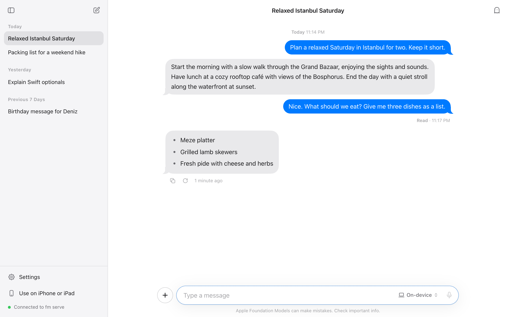
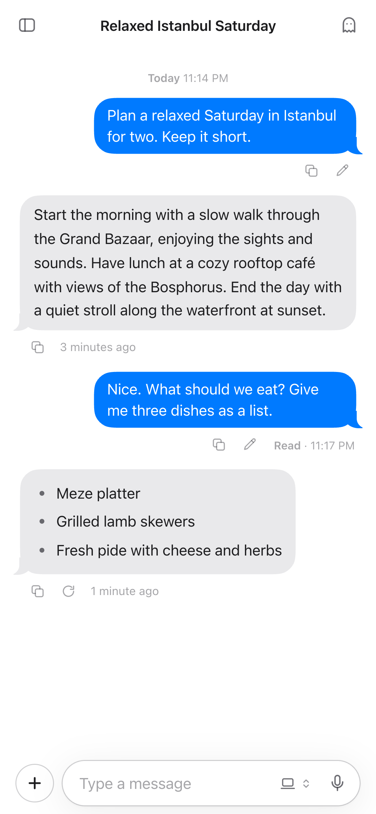
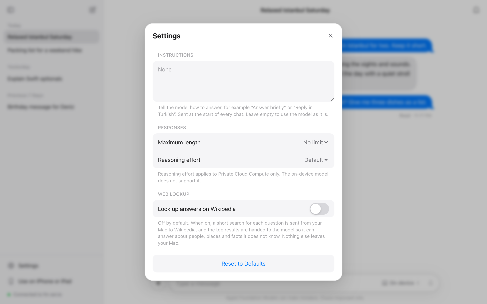

<h1 align="center">AFMGUI</h1>

<p align="center">
  A clean chat app for <b>Apple's Foundation Models</b>, running on your own Mac.<br>
  One command, no accounts, no dependencies, no build step.
</p>

<p align="center">
  <a href="LICENSE"></a>
  
  
</p>

<p align="center">
  <picture>
    <source media="(prefers-color-scheme: dark)" srcset="docs/screenshot-dark.png">
    
  </picture>
</p>

macOS ships a command called `fm`, and `fm serve` turns Apple's on-device model into a local, OpenAI-compatible API. AFMGUI puts a real chat app on top of it: it looks and feels like Messages, works in any browser, and you can open it from your iPhone or iPad on the same Wi-Fi.

## Quick start

```bash
git clone https://github.com/BLCNYY/AFMGUI.git
cd AFMGUI
npm start
```

Then open **http://localhost:1977**. That's it. There is nothing to install, and `fm serve` is started for you.

<p align="center">
  
  &nbsp;&nbsp;
  
</p>

## Features

- **Streaming replies** that appear word by word, with safe Markdown (lists, bold, tables, code blocks with a copy button).
- **Images**: attach with the + button, paste, or drag and drop (up to 4). Images are resized to 1024 px and sent only with the message they belong to, which keeps the small context window free.
- **Dictation** with Apple's own speech recognition (Safari on Mac, any browser on iPhone/iPad), with live text as you speak.
- **Model picker** for On-device (`system`) and Private Cloud Compute (`pcc`). The list comes from `fm serve`'s `/health`, so unavailable models show the reason.
- **Clear errors**: fm serve not running, message too long, safety guardrails, PCC unavailable, connection lost.
- **Long chats keep working**: older turns are left out automatically when a conversation outgrows the model's ~4k-token context.
- **Feels like Messages**: bubbles with tails, time stamps, and a Delivered / Read status under your last message.
- **Chat history** in a sidebar, stored only in your browser. The model names each chat for you, and you can rename it with the pencil. Deleting a chat asks first, and can be undone.
- **Temporary chat**: the ghost button starts a conversation that is never saved.
- **Edit and retry**: edit a message you sent to ask again, or regenerate an answer and flip between the versions.
- **Settings**: your own instructions for the model, a maximum answer length, reasoning effort for Private Cloud Compute, and an optional Wikipedia lookup. Everything is off by default, so the model is used exactly as it is until you change something.
- Automatic **light/dark mode**, works on phone, tablet and laptop, and installs to the iPhone home screen.

## Requirements

- A Mac with Apple Intelligence turned on and the `fm` command-line tool (`/usr/bin/fm`). Check with `fm --help`. Built and tested on macOS 27.
- [Node.js](https://nodejs.org) 18 or newer. There are no npm dependencies, so no `npm install`.

## Running it

```bash
npm start
```

This one command:

1. Serves the app on **port 1977**, on all network interfaces so your other devices can reach it.
2. Serves HTTPS on **port 1978** (needed for dictation on iPhone/iPad, see below).
3. Starts plain `fm serve` for you if it isn't already running, and stops it again when you press Ctrl+C. If you already run `fm serve` yourself, it uses that one.

The terminal prints the addresses to open, for example:

```
  AFMGUI is running

  This Mac    http://localhost:1977
  Network     http://192.168.1.4:1977
  HTTPS       https://192.168.1.4:1978  for dictation on iPhone/iPad

  fm serve    running at http://127.0.0.1:1976
```

### Private Cloud Compute

`fm serve` only offers the `pcc` model when it was started from **Terminal.app**. Run `npm start` (or `fm serve`) from Terminal.app if you want to use it. Otherwise the picker shows it as unavailable.

## Using it on iPhone or iPad

Open the **Network** address (for example `http://192.168.1.4:1977`) on any device on the same Wi-Fi. Chatting works right away.

**Dictation** needs a secure (HTTPS) page in Safari. On your Mac, `http://localhost` already counts as secure, so dictation just works there. On other devices, do this one-time setup:

1. In Safari on the device, open `http://<your-mac-ip>:1977/ca.crt` and tap **Allow** to download the profile.
2. Open **Settings**, tap **Profile Downloaded** (or *General › VPN & Device Management*) and install **AFMGUI Local CA**.
3. Go to **Settings › General › About › Certificate Trust Settings** and turn on **AFMGUI Local CA**.
4. Open `https://<your-mac-ip>:1978`.

A short version with your Mac's real addresses is in the app under **Use on iPhone or iPad** in the sidebar.

About the certificate: the server creates it on first run in `.certs/` using macOS's built-in `openssl`. The certificate authority is **name-constrained**, so it can only vouch for `localhost`, `*.local` names and private-network IP addresses, never for real websites. Its private key never leaves your Mac. Delete `.certs/` to start over.

### Why dictation is Safari-only

In Safari, and in every browser on iPhone and iPad (they all use WebKit), the Web Speech API is backed by Apple's speech recognition. Desktop Chrome, Edge and others send your audio to their own vendor's service instead. So in those browsers the mic button is greyed out and shows "Works only on Safari".

## Troubleshooting

| What you see | What to do |
| --- | --- |
| "fm serve isn't running" | Run `fm serve` in a terminal and look at what it prints. If `fm` is not found, your macOS version does not include it. |
| Private Cloud Compute is greyed out | Start `npm start` (or `fm serve`) from **Terminal.app**. |
| The mic is greyed out | Dictation works in Safari only, see above. On iPhone and iPad it also needs the HTTPS address. |
| The page doesn't load on your phone | Both devices must be on the same Wi-Fi, and the macOS firewall must allow incoming connections for `node`. |
| "Port 1977 is in use" | Start it on another port: `PORT=8080 npm start`. |

## Configuration

| Variable | Default | What it does |
| --- | --- | --- |
| `PORT` | `1977` | HTTP port |
| `HTTPS_PORT` | `PORT + 1` | HTTPS port |
| `HOST` | `0.0.0.0` | Bind address. Use `127.0.0.1` to keep it to this Mac only. |
| `FM_URL` | `http://127.0.0.1:1976` | Where `fm serve` listens |
| `ALLOWED_HOSTS` | | Extra host names allowed to open the app (comma separated) |
| `SPAWN_FM=0` / `--no-fm` | | Don't start `fm serve` automatically |
| `HTTPS=0` / `--no-https` | | Don't serve HTTPS |

Example: `PORT=8080 npm start`

## How it works

```
Browser ──(same origin)──▶ server.mjs ──▶ fm serve (127.0.0.1:1976)
           /, /health, /v1/*               /health, /v1/models, /v1/chat/completions
```

`fm serve` rejects requests that a browser marks as cross-site (`Sec-Fetch-Site: cross-site` / `same-site`), so a page on another port can't call it directly. `server.mjs` serves the app and forwards `/health` and `/v1/*` to `fm serve`, dropping the browser's `Origin`, `Referer` and `Sec-Fetch-*` headers. Replies stream through unchanged as server-sent events.

`fm serve` itself stays on its default, local-only `127.0.0.1:1976`.

### Settings

Settings only use what `fm serve` really supports:

| Setting | What is sent |
| --- | --- |
| Instructions | A `system` message at the start of each request. Empty means none. |
| Maximum length | `max_completion_tokens` |
| Reasoning effort | `reasoning_effort` (`low`, `medium`, `high`). Private Cloud Compute only. |
| Web lookup | Nothing extra to `fm serve`. See below. |

`fm serve` ignores `temperature`, `top_p` and `seed`, so the app has no controls for them.

**Web lookup** is off by default. When on, the app asks the model which Wikipedia article fits your question, the server fetches up to three article summaries from Wikipedia (`POST /_app/lookup`), and they are added to that one request. The answer shows its sources underneath. Greetings and very short messages skip the lookup.

Security choices, since the server is reachable on your network:

- **Cross-site protection is kept.** The proxy rejects cross-site browser requests itself, so other websites still can't drive the model through it.
- **DNS-rebinding protection.** Only requests addressed to this Mac (IP addresses, `localhost`, its `.local` name or `ALLOWED_HOSTS`) are answered.
- **Strict Content-Security-Policy.** Same-origin scripts only. Model output is HTML-escaped before Markdown is applied, and links are limited to http(s)/mailto.

## Privacy

- Conversations go to `fm serve` on your Mac. With **On-device** they never leave the Mac. **Private Cloud Compute** uses Apple's PCC.
- Chat history is stored in your browser's local storage on each device, with small image thumbnails only. Temporary chats are never stored. Full-size images are kept in memory just for the turn they're sent with.
- Web lookup is off unless you turn it on in Settings. When on, a short search for each question goes from your Mac to Wikipedia. Nothing else is sent anywhere.
- Dictation uses Apple's speech recognition through Safari, under Apple's own permission prompt.

## Project layout

```
server.mjs            zero-dependency static server + fm serve proxy + HTTPS + Wikipedia lookup
public/index.html     app shell and icons
public/css/app.css    styles (light/dark)
public/js/app.js      chat UI, streaming, composer, model picker, settings
public/js/api.js      fm serve client (SSE parsing, error mapping)
public/js/markdown.js safe Markdown renderer
public/js/images.js   image decoding, resizing, thumbnails
public/js/dictation.js  Safari speech recognition
public/js/squircle.js continuous-corner shape for the composer and messages
public/js/store.js    local chat history
```

## Contributing

Issues and pull requests are welcome. See [CONTRIBUTING.md](CONTRIBUTING.md). The whole app is plain HTML, CSS and JavaScript with no build step, so edit a file and reload the page.

## Credits

The squircle shape follows the corner-smoothing method from [figma-squircle](https://github.com/phamfoo/figma-squircle) (MIT). Icons are drawn in the style of SF Symbols.

## License

[MIT](LICENSE)

AFMGUI is an independent open-source project. It is not affiliated with or endorsed by Apple. Apple, Apple Intelligence, Safari, iPhone, iPad and Mac are trademarks of Apple Inc.
